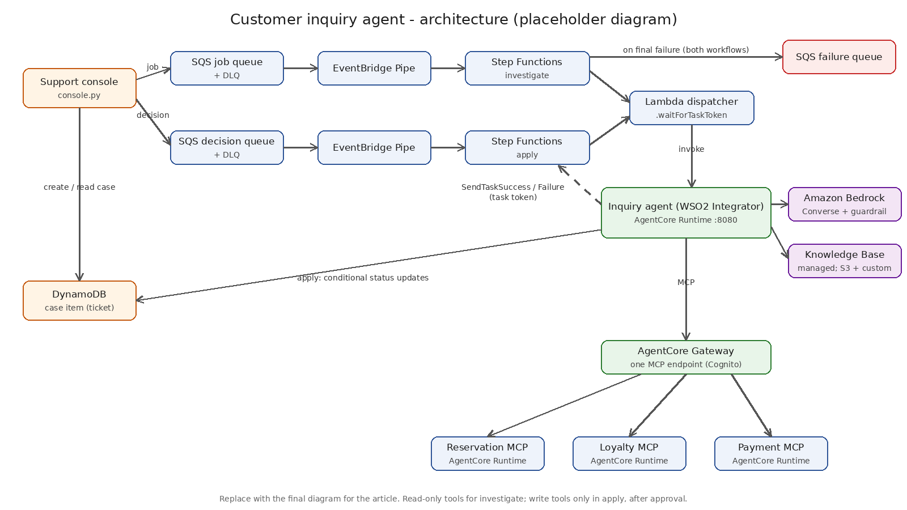

# Customer inquiry agent with Amazon Bedrock and WSO2 Integrator

Sample code for the AWS blog post "[article title]".

An inquiry agent built with WSO2 Integrator picks up investigation jobs from
Amazon SQS, reasons with Amazon Bedrock models behind a guardrail, and
retrieves runbooks and past cases from an Amazon Bedrock Managed Knowledge Base.
It gathers evidence through Amazon Bedrock AgentCore Gateway, and every change
it proposes waits for a person's approval.

> Work in progress. Uses synthetic data only.

## Overview

Support teams at a hotel and resort group spend much of their time on questions like "why
does my confirmation show the old dates?" Answering them means checking several internal
systems, finding the right runbook, and then making a small correction. This sample hands
the checking to an agent and keeps the correction with a person:

1. A representative sends an **investigation job** from a support console.
2. The **inquiry agent**, built with WSO2 Integrator (Ballerina), looks up the reservation,
   loyalty and payment records with **read-only tools**, and searches runbooks, policies and
   past cases in a **knowledge base**.
3. It returns **findings**, **one proposed fix** and a **draft reply**. Personal data is masked
   in its output by an Amazon Bedrock guardrail.
4. The representative **approves or rejects**. Only an approved fix is applied, exactly as
   stored, and only once.
5. The resolved case is added to the knowledge base, so similar inquiries are faster next time.

## Architecture



- **Queues and workflows:** the console sends jobs to an Amazon SQS standard queue with a
  dead-letter queue. Amazon EventBridge Pipes start one AWS Step Functions Standard workflow per
  job. The workflow calls the agent through a small AWS Lambda dispatcher and waits on a task
  token. It handles the timeout, retries and failure: on final failure the case is marked
  `FAILED` and the job goes to a failure queue.
- **Inquiry agent:** a WSO2 Integrator HTTP service on Amazon Bedrock AgentCore Runtime (ARM64,
  port 8080). `POST /invocations` answers "accepted" at once and works in the background, while
  `GET /ping` reports `HealthyBusy`. When it is done, the agent reports to Step Functions with
  `SendTaskSuccess` or `SendTaskFailure`. Each invocation is stateless.
- **Model and knowledge:** the Amazon Bedrock Converse API with a guardrail that masks personal
  data, and an Amazon Bedrock managed knowledge base with an S3 data source (runbooks and
  policies) and a custom data source (resolved cases).
- **Tools:** every tool call goes through one Amazon Bedrock AgentCore Gateway MCP endpoint,
  with Amazon Cognito client-credentials auth. Its targets are reservation, loyalty and payment
  MCP servers built with WSO2 Integrator and hosted on AgentCore Runtime. Each serves its own
  synthetic data. The investigate action can use only the read-only tools.
- **Approval:** the decision goes to a second SQS queue as a new message that carries only
  `caseId`, `decision` and `proposalVersion`. A pipe starts the apply workflow, and the agent's
  apply action loads the stored proposal, claims the case with a conditional update, calls the
  one write tool, and marks the case `APPLIED`.
- **Case record:** the mock console keeps cases in a small Amazon DynamoDB table. In production,
  this record would be the ticket in the team's support system.

See [docs/architecture.md](docs/architecture.md) for the flows, statuses and message formats,
and [docs/security.md](docs/security.md) for the security notes.

### Optional gateway targets

The gateway can front more than the internal MCP servers in this sample. For example, a team
could add targets for Salesforce (customer records), ServiceNow (incidents and changes) or
Elastic (application logs) to widen the evidence the agent can gather. These are not built
here. If you add one, list its read-only tools in `inquiry-agent/modules/core/tools.bal`.

## What's in this repo

| Path | Contents |
| --- | --- |
| [`inquiry-agent/`](inquiry-agent/) | WSO2 Integrator (Ballerina) inquiry agent for AgentCore Runtime: investigate and apply actions |
| [`mcp-servers/`](mcp-servers/) | Reservation, loyalty and payment MCP servers (WSO2 Integrator) with bundled synthetic data |
| [`data/`](data/) | Runbooks, policies, seed resolved cases and the three sample inquiries |
| [`infra/`](infra/) | CloudFormation templates, Step Functions definitions, Lambda dispatcher, AgentCore and knowledge base request templates |
| [`scripts/`](scripts/) | Deploy steps, clean-up and the support console (`console.py`) |
| [`docs/`](docs/) | Architecture and security notes |

## Prerequisites

- An AWS account and a Region where Amazon Bedrock AgentCore and managed knowledge bases are
  available. The defaults use `us-east-1`.
- Access to Claude Sonnet 5.5 in Amazon Bedrock through the US cross-Region inference profile
  (`us.anthropic.claude-sonnet-5-5`). To use another model, set `MODEL_ID` in `scripts/env.sh`.
- Permissions to create the resources listed in [`infra/README.md`](infra/README.md),
  including IAM roles.
- A recent AWS CLI v2 with the `bedrock-agent` and `bedrock-agentcore-control` commands.
- Docker with `buildx` and ARM64 support (QEMU emulation works on x86 machines).
- `jq`, and Python 3.11 or later with `boto3` (`pip install -r scripts/requirements.txt`).
- Optional, for local builds and tests: [WSO2 Integrator](https://wso2.com/integrator/) or
  Ballerina 2201.14.0.

## Deploy

1. Copy the settings file and edit it. Choose a unique Cognito domain prefix.

   ```bash
   cp scripts/env.example.sh scripts/env.sh
   ```

2. Run the deploy script. It runs seven steps; each one can also be run on its own, and saves
   what it creates to `.deploy/outputs.env`.

   ```bash
   ./scripts/deploy.sh
   ```

   | Step | Script | Creates |
   | --- | --- | --- |
   | 1 | `01-foundation.sh` | Queues, case table, bucket, ECR repositories, guardrail, Cognito clients, IAM roles |
   | 2 | `02-build-push.sh` | Four ARM64 images in Amazon ECR |
   | 3 | `03-knowledge-base.sh` | Managed knowledge base, S3 and custom data sources, seeded content |
   | 4 | `04-mcp-runtimes.sh` | Three MCP server runtimes |
   | 5 | `05-gateway.sh` | OAuth credential provider, gateway and three targets |
   | 6 | `06-agent-runtime.sh` | Inquiry agent runtime |
   | 7 | `07-workflows.sh` | Dispatcher, two state machines, two pipes |

Some AgentCore and managed knowledge base requests are marked `TODO(verify)` because those
APIs are new. If a step fails, check the request template it uses in `infra/` against the
current AWS CLI reference. See [Known limits](#known-limits).

## Try it

Install the console's dependency, then submit each sample inquiry. Each command prints the
case ID to use in the next one.

```bash
pip install -r scripts/requirements.txt
```

### 1. "I changed my booking dates in the app, but my confirmation still shows the old dates."

```bash
python3 scripts/console.py submit --sample 1
```

```bash
python3 scripts/console.py show <caseId> --watch
```

Expected findings: reservation `R-48213` is at version 3 with the new dates, the confirmation
job for that change failed, and the latest confirmation is still version 2. Proposed change:
`reservation___reissueConfirmation` for `R-48213`.

### 2. "I stayed last weekend, but my loyalty points never showed up."

```bash
python3 scripts/console.py submit --sample 2
```

Expected findings: stay `S-90551` for member `M-77310` closed after the nightly accrual batch
ran, so its accrual is `FAILED`. Proposed change: `loyalty___creditPoints` with 3,465 points
(630.00 qualifying spend × 5 base points, plus the 10% Gold bonus).

### 3. "There's a charge on my card from the resort that I don't recognize."

```bash
python3 scripts/console.py submit --sample 3
```

Expected findings: `CH-7003` (`RESORT INCIDENTALS 0423`) is the check-in hold `CH-7001`
captured by the reconciliation job, although the folio shows no incidentals. Proposed change:
`payment___refundCharge` for `CH-7003`, 250.00.

### Approve and check the result

Review the findings and draft reply, then approve (or `--reject`):

```bash
python3 scripts/console.py decide <caseId> --approve
```

```bash
python3 scripts/console.py show <caseId> --watch
```

Check the result in two places on the case:

- the status is `APPLIED`, and
- the **write tool response** shows the receipt, for example a new confirmation number for
  version 3, the points adjustment for `S-90551`, or the refund of `CH-7003`.

Do not check by reading the records again through the tools. Each MCP server keeps its data in
memory, and AgentCore Runtime runs each session in its own microVM, so a later read may not see
the change.

Other useful commands:

```bash
python3 scripts/console.py list
```

```bash
python3 scripts/console.py failures
```

## Clean up

To avoid ongoing charges, delete everything the deploy scripts created:

```bash
./scripts/cleanup.sh
```

The script deletes the workflows, runtimes, gateway, credential provider, knowledge base,
bucket contents, gateway client secret and the foundation stack, in that order. Check its
output for anything it reports as skipped.

## Known limits

- **Not compiled in this repository's history.** The Ballerina code was written against the
  current `ballerina/ai`, `ballerina/mcp`, `ballerinax/ai.aws.bedrock`, `ballerinax/aws.dynamodb`
  and `ballerinax/aws` module sources, but has not been built with `bal build` here. Run
  `bal build` and `bal test` in each package before you deploy.
- **Items marked `TODO(verify)`:** search the repository for `TODO(verify)`. They cover the
  AgentCore CLI request shapes (runtimes, gateway, targets, OAuth credential provider), the
  runtime endpoint URL used for gateway targets, the gateway tool-name prefix (`<target>___<tool>`),
  the S3 data source parameters for a managed knowledge base, IAM details for managed knowledge
  bases and the gateway, the Ballerina and Java image tags, and whether the Ballerina MCP
  stateless mode accepts the `Mcp-Session-Id` header AgentCore Runtime adds.
- **Dispatcher Lambda:** the Step Functions integration for AgentCore supports only Request
  Response, so a Lambda function bridges the task token. Stopping a workflow does not stop an
  agent invocation that is already running.
- **In-memory tool data:** each MCP server loads its synthetic data at startup and keeps
  changes in memory for its runtime session only. Verify fixes through the case status and the
  stored write-tool response.
- **Scopes are not enforced per tool at the gateway.** The read and write split is enforced by
  the agent (tool allow lists) and by separate Cognito clients, not by gateway policy.
- **Guardrail scope:** personal data is masked in model output only; input is checked but not
  changed. Card security codes are blocked.
- **No approver identity:** the console does not record who approved a change. A real support
  system would.
- **Retries after a claim stop at `NEEDS_REVIEW`.** If an apply attempt times out after claiming
  the case, a person must check whether the change was made.
- **Pipes start Standard workflows fire-and-forget,** so a message is removed from its queue as
  soon as its workflow starts. A message whose body is not valid JSON fails the workflow without
  reaching the failure queue; check failed executions in the Step Functions console.
- **Public network mode** for the runtimes, and AWS owned or managed encryption keys.

## License

This sample is licensed under the Apache License 2.0. See [LICENSE](LICENSE).
