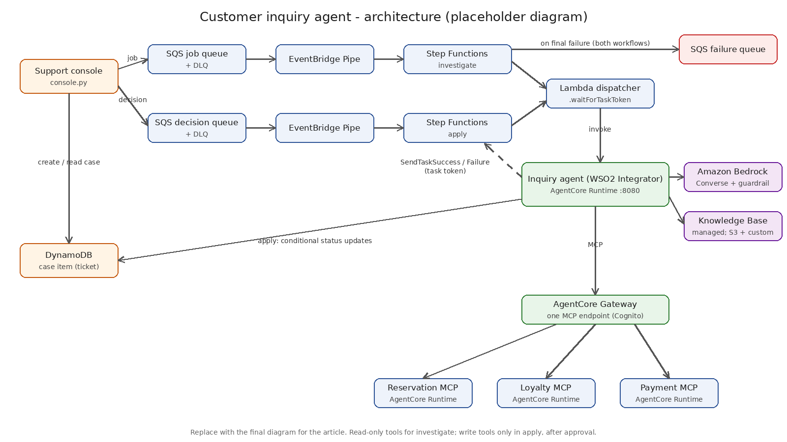

# Architecture



The diagram is a placeholder, to be replaced by the final diagram for the article.

## Components

| Component | Service | Role |
| --- | --- | --- |
| Support console | `scripts/console.py` | Creates the case, sends the job, shows findings, sends the decision |
| Case item | Amazon DynamoDB | One item per case. Stands in for the ticket in the team's support system |
| Job queue, decision queue | Amazon SQS (standard, each with a DLQ) | Buffer work from the console |
| Pipes | Amazon EventBridge Pipes | Start one workflow execution per message (batch size 1) |
| Investigate and apply workflows | AWS Step Functions (Standard) | Status changes, timeouts, retries, failure handling |
| Dispatcher | AWS Lambda | Starts one agent invocation and returns (see "Why a dispatcher") |
| Inquiry agent | WSO2 Integrator on Amazon Bedrock AgentCore Runtime | Investigates (read-only) or applies one approved change |
| Model and guardrail | Amazon Bedrock (Converse API) | Reasoning; personal data masked in output |
| Knowledge base | Amazon Bedrock managed knowledge base | Runbooks and policies (S3 source), resolved cases (custom source) |
| Tool endpoint | Amazon Bedrock AgentCore Gateway | One MCP endpoint for all tools, Cognito client-credentials inbound |
| Internal systems | WSO2 Integrator MCP servers on AgentCore Runtime | Reservation, loyalty and payment tools over synthetic data |
| Failure queue | Amazon SQS | Jobs and decisions that failed after retries |

## Investigation flow

1. The console writes the case item (`RECEIVED`) and sends the job to the job queue.
2. The pipe starts the `investigate` state machine with the message.
3. The state machine sets `INVESTIGATING` (only if the case is `RECEIVED`, so a duplicate
   delivery does nothing) and calls the dispatcher with `.waitForTaskToken`.
4. The dispatcher calls `InvokeAgentRuntime` with `{action: "investigate", taskToken, caseId, job}`
   in a new runtime session and returns once the agent answers `accepted`.
5. The agent runs in the background while `/ping` reports `HealthyBusy`. It uses only the
   gateway's read-only tools and the knowledge base, then checks its proposal.
6. The agent calls `SendTaskSuccess` with the findings. The state machine stores them on the
   case, increments `proposalVersion` and sets `PENDING_APPROVAL` (or `NO_ACTION_PROPOSED`).
7. On a timeout or error the task is retried twice with backoff. After that the case becomes
   `FAILED` and the job goes to the failure queue.

## Approval flow

1. The representative reviews the case and approves or rejects. The console sends
   `{caseId, decision, proposalVersion}` to the decision queue. Nothing else travels.
2. The pipe starts the `apply` state machine.
3. **Rejected:** the state machine sets `REJECTED` if the case is still `PENDING_APPROVAL` at
   that version.
4. **Approved:** the dispatcher starts the agent with `{action: "apply", taskToken, caseId, proposalVersion}`.
   The agent:
   1. sets `APPLYING` with a conditional update (status `PENDING_APPROVAL` and matching version),
   2. reads the stored proposal and calls that one write tool through the gateway with
      `approvalId = <caseId>#<proposalVersion>`,
   3. sets `APPLIED` (only if still `APPLYING`) and stores the tool's response,
   4. adds a resolved-case summary to the knowledge base's custom data source,
   5. calls `SendTaskSuccess`.
5. If a retry finds the case already `APPLYING`, an earlier attempt may have made the change.
   The agent does not call the tool again; it sets `NEEDS_REVIEW` and fails the task with
   `CaseNeedsReview`. The state machine leaves the status alone and sends the decision to the
   failure queue.
6. If the task fails before the case was claimed, the state machine sets `FAILED`. If it fails
   while the case is `APPLYING` (for example, a timeout), it sets `NEEDS_REVIEW`.

## Case statuses

```
RECEIVED -> INVESTIGATING -> PENDING_APPROVAL -> APPLYING -> APPLIED
                         \-> NO_ACTION_PROPOSED   |   \-> NEEDS_REVIEW
                         \-> FAILED               \-> REJECTED / FAILED
```

## Case item

| Attribute | Type | Written by |
| --- | --- | --- |
| `caseId` | S (key) | console |
| `status` | S | console, state machines, agent (apply) |
| `job` | S (JSON) | console |
| `findings` | S (JSON) | investigate state machine |
| `proposedAction` | S (JSON, or `null`) | investigate state machine |
| `draftReply` | S | investigate state machine |
| `proposalVersion` | N | investigate state machine (incremented per investigation) |
| `applyResult` | S (JSON) | agent (apply) |
| `failureReason` | S | state machines, agent |
| `createdAt`, `updatedAt` | S | all writers |

In production this record would be the ticket in the team's support system, and the console
would be that system's user interface.

## Messages

Job (job queue and `job` on the case):

```json
{
  "caseId": "CASE-20261103-1a2b3c",
  "customerRef": "G-15562",
  "inquiry": "I stayed last weekend, but my loyalty points never showed up.",
  "channel": "chat",
  "context": {"memberId": "M-77310"},
  "submittedAt": "2026-11-03T09:15:00Z"
}
```

Decision (decision queue):

```json
{"caseId": "CASE-20261103-1a2b3c", "decision": "APPROVED", "proposalVersion": 1}
```

Invocation (dispatcher to agent, `POST /invocations`):

```json
{"action": "apply", "taskToken": "<token>", "caseId": "CASE-20261103-1a2b3c", "proposalVersion": 1}
```

Findings (agent to Step Functions):

```json
{
  "caseId": "CASE-20261103-1a2b3c",
  "findings": {
    "summary": "...",
    "evidence": [{"source": "loyalty___listStays", "detail": "Stay S-90551 ... accrual FAILED"}],
    "rootCause": "...",
    "proposedAction": {
      "tool": "loyalty___creditPoints",
      "arguments": {"memberId": "M-77310", "stayId": "S-90551", "points": 3465},
      "rationale": "..."
    },
    "draftReply": "...",
    "confidence": "high",
    "knowledgeSources": ["runbooks/loyalty-points.md", "policies/points-earning.md"]
  }
}
```

## Why a dispatcher

The Step Functions integration for Amazon Bedrock AgentCore supports only the Request
Response pattern, not Wait for a Callback with a task token. The Lambda dispatcher is invoked
with `.waitForTaskToken`, starts the agent, and returns. The agent then reports with the token.
If the integration gains callback support, the dispatcher can be replaced by a direct task.

## Why the agent is not a queue listener

Each job is one short-lived invocation. AgentCore Runtime starts a fresh session per
invocation and stops it when the agent goes idle, so nothing runs between jobs. The agent
keeps no memory between invocations (`memory = ()`); durable state lives in DynamoDB, Step
Functions and the knowledge base.

## Read-only during investigation

1. The investigate action loads only the read tools (`ai:McpToolKit` with `permittedTools`).
2. It gets gateway tokens from the investigator Cognito client, which has only the read scope.
3. A proposal is only data until approved. The apply action calls the stored proposal, only if
   it names a tool on the write list, with tokens from the applier client (write scope).
4. Write tools require an `approvalId` and are idempotent per `approvalId`.

Gateway-side enforcement of scopes per tool is not configured in this sample (see Known limits
in the main README).
